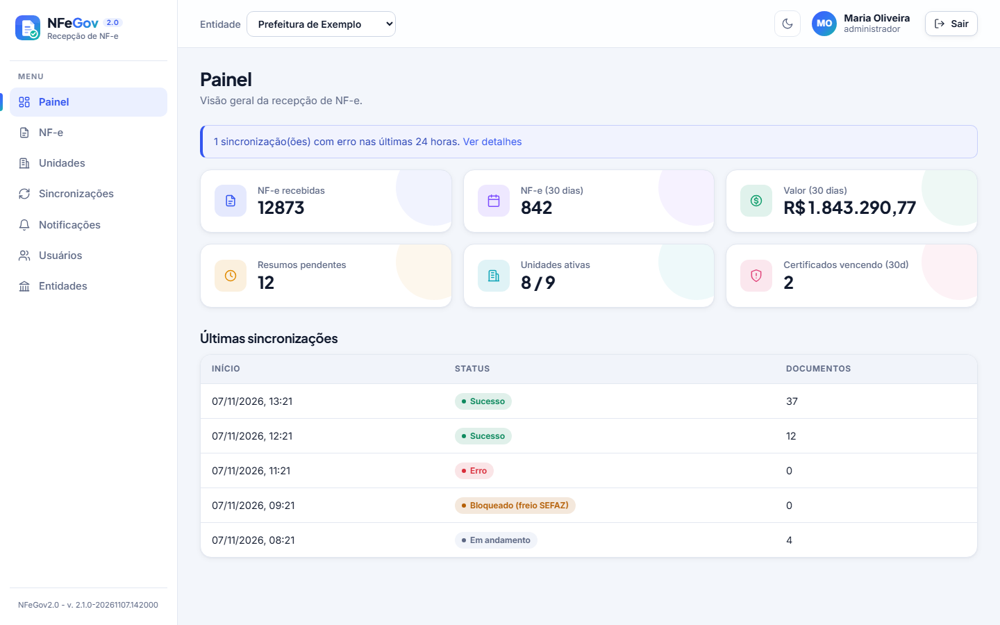
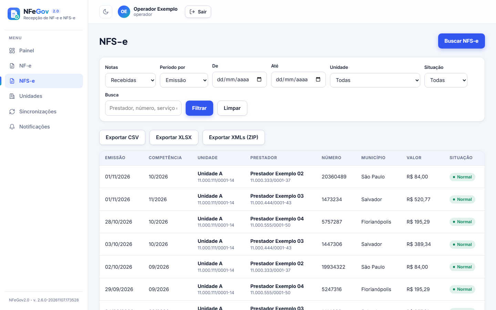

# NFeGov 2.0

**NFE-Gov 2.0** — sistema multitenant de recepção e consulta de **NF-e** e **NFS-e** para entidades públicas.

Conecta-se periodicamente à SEFAZ (NF-e, de hora em hora) e ao Ambiente de Dados Nacional da NFS-e (a cada
3 horas), via certificado digital e-CNPJ de cada unidade gestora, para baixar todas as notas
destinadas ao CNPJ da unidade, armazená-las e disponibilizá-las para consulta.

Reescrita do [helesjunior/nfegov](https://github.com/helesjunior/nfegov) com Laravel 13 + PHP 8.4,
API REST e SPA React.

## Stack

| Camada | Tecnologia |
|---|---|
| Backend | Laravel 13 (API REST) |
| Frontend | React + Vite + TypeScript |
| Banco | PostgreSQL 16 |
| Fila / Cache | Redis + Laravel Horizon |
| Autenticação | Laravel Sanctum (SPA same-origin) + MFA (TOTP) |
| RBAC | spatie/laravel-permission |
| Integração SEFAZ (NF-e) | nfephp-org/sped-nfe ^5.2 |
| Integração NFS-e Nacional | API REST do ADN e da SEFIN Nacional, com mTLS (cliente cURL próprio) |
| Infra | Docker + docker compose |

## Escopo fiscal

Este sistema faz **recepção e consulta** de documentos fiscais. Não há emissão.

**NF-e (modelo 55)**, pela SEFAZ:

- recepção do `distDFeInt` (consulta por NSU, incremental);
- consulta por chave de acesso;
- download do XML completo (após ciência da operação);
- manifestação do destinatário — **apenas ciência da operação** (`210210`), automática ao
  receber um `resNFe`;
- geração de DANFE (PDF) sob demanda.

**NFS-e (padrão nacional)**, pelo Ambiente de Dados Nacional (ADN):

- recepção da fila de distribuição do contribuinte (`GET /DFe/{NSU}`, incremental, com
  histórico completo desde o primeiro documento do CNPJ);
- notas **recebidas** (a unidade é a tomadora), **emitidas** e **intermediadas**, com o
  `papel` da unidade em cada nota, e seus **eventos** (cancelamento, substituição,
  manifestações), que atualizam a situação da nota;
- busca manual por chave de acesso (50 dígitos);
- **manifestação do tomador** (Confirmação `203202` ou Rejeição `203206`) na SEFIN Nacional,
  sempre por ação explícita do usuário;
- geração local do **DANFSe** (PDF) no leiaute da NT SE/CGNFS-e nº 008;
- exportação CSV/XLSX dos metadados e ZIP dos XMLs.

Só aparecem notas de municípios que **compartilham** seus documentos com o ambiente nacional
(obrigatório desde 01/01/2026 pela LC 214/2025, mas a cobertura não é garantida como a da
NF-e). Para essas notas não existe API nacional: só o webservice próprio de cada prefeitura,
fora do escopo.

## Estrutura

```
nfegov2.0/
├── backend/          # Laravel 13 (API REST)
│   ├── app/          # domínio (Sefaz, Nfe, Nfse...), jobs, controllers, policies
│   ├── database/     # migrations, seeders
│   ├── resources/    # recursos do backend (ex.: logomarca do DANFSe)
│   ├── routes/       # api.php, console.php
│   ├── tests/        # Unit + Feature (inclui EndToEnd)
│   └── tools/        # scripts de apoio (seed de demonstração)
├── frontend/         # React + Vite (SPA)
├── docker/           # Dockerfile do PHP e config do Nginx
├── docs/             # design, specs e planos de implementação (ver índice em docs/README.md)
└── docker-compose.yml
```

## Requisitos

- Docker e Docker Compose
- (Desenvolvimento do frontend) Node.js 20+

## Como subir

```bash
# 1. Variáveis de ambiente
cp backend/.env.example backend/.env
#    Gere a chave e ajuste DB/Redis/mail conforme o ambiente
docker compose run --rm app php artisan key:generate

# 2. Suba a stack completa (app, nginx, postgres, redis, horizon, scheduler)
docker compose up -d --build

# 3. Migre o banco e popule os papéis/usuário inicial
docker compose exec app php artisan migrate --seed
```

A aplicação sobe em `http://localhost:8080`.

## Serviços

| Serviço | Papel |
|---|---|
| `app` | PHP-FPM (aplicação Laravel) |
| `nginx` | Front controller e arquivos estáticos (`/spa`) |
| `postgres` | Banco de dados |
| `redis` | Cache, fila e rate limiter global |
| `horizon` | Processamento das filas — `default` (exportações), `sefaz` (sync de NF-e) e `adn` (NFS-e) |
| `scheduler` | `schedule:work`: dispara os syncs de NF-e e de NFS-e e os alertas de certificado |

## Painel

A tela inicial mostra a visão geral da entidade ativa, em dois blocos:

- **NF-e:** recebidas, últimos 30 dias, valor, resumos pendentes, unidades ativas e
  certificados vencendo; gráficos de **NF-e por dia** (30 dias) e **maiores fornecedores**.
- **NFS-e** (com a recepção ligada): recebidas, últimos 30 dias, valor dos serviços, notas
  **sem manifestação** do tomador e canceladas; gráficos de **NFS-e por dia** e **maiores
  prestadores**. Os números contam as notas **recebidas**; canceladas e substituídas ficam
  fora do valor e dos gráficos.
- Alertas de **freio** da SEFAZ e do ADN (separados), certificados vencidos e execuções com
  erro, e a tabela das **últimas sincronizações** (com o tipo de documento de cada uma).

Tudo respeita a entidade ativa e a permissão `nfe.view`. Com `NFEGOV_ADN_HABILITADO=false` o
bloco de NFS-e some.

### Capturas de tela

Os dados das capturas são **fictícios**: nomes de empresas, CNPJs, e-mail e nome do usuário
foram trocados por valores genéricos antes de cada print; valores, datas, números de nota e
municípios são os do ambiente em que a captura foi feita.

| Tela | Captura |
|---|---|
| Login | [`docs/capturas/login.png`](docs/capturas/login.png) |
| Painel (NF-e e NFS-e), tema claro e escuro | [`painel.png`](docs/capturas/painel.png) · [`painel-escuro.png`](docs/capturas/painel-escuro.png) |
| Lista de NF-e | [`docs/capturas/nfes.png`](docs/capturas/nfes.png) |
| Lista de NFS-e (recebidas, filtros, exportações) | [`docs/capturas/nfses.png`](docs/capturas/nfses.png) |
| Detalhe da NFS-e (partes, manifestação pendente, eventos) | [`docs/capturas/nfse-detalhe.png`](docs/capturas/nfse-detalhe.png) |
| Diálogo de manifestação do tomador (rejeição) | [`docs/capturas/nfse-manifestacao.png`](docs/capturas/nfse-manifestacao.png) |
| Sincronizações (NF-e e NFS-e) | [`docs/capturas/sincronizacoes.png`](docs/capturas/sincronizacoes.png) |
| Unidades | [`docs/capturas/unidades.png`](docs/capturas/unidades.png) |





## Operação

### Sincronização com a SEFAZ (NF-e)

O scheduler roda `SyncNfe` a cada `NFEGOV_SYNC_INTERVAL_HOURS` horas (padrão **1**, todos os dias); só em
dias úteis se `NFEGOV_SYNC_WEEKDAYS_ONLY=true` (ver `routes/console.php`).
Esse comando despacha o `DispatchSyncNfeJob`, que **escalona** as unidades ativas ao longo
da janela (`slot_window_minutes`, padrão 180 min, nunca maior que o intervalo) para não criar
picos — o limite da SEFAZ é por IP, e todos os tenants compartilham a mesma saída.

**Regra de 1 hora da SEFAZ.** Quando a fila de uma unidade é lida até o fim
(`ultNSU = maxNSU`), a SEFAZ exige 1 hora sem consultá-la; antes disso responde `656`. O
horário fica em `nsus.fila_vazia_em` e nenhuma consulta pela fila (agendador, comando
manual, busca manual de nota) sai antes de `NFEGOV_SEFAZ_ESPERA_FILA_VAZIA_MINUTES`
(padrão 61): o `SyncNfeJob` se reagenda para o fim da espera.

**Continuação.** Se a execução para no teto (150 consultas ou 100 documentos) e a fila
ainda tem documentos, a próxima parte começa em `NFEGOV_SEFAZ_CONTINUACAO_SECONDS`
(padrão 60), sem esperar a próxima rodada. Uma unidade nunca tem duas execuções ao mesmo
tempo. Detalhes e evidências em
[`docs/superpowers/specs/2026-11-07-ritmo-sync-nfe-design.md`](docs/superpowers/specs/2026-11-07-ritmo-sync-nfe-design.md).

**Freio anti-bloqueio** (réplica dos limites do sistema legado):

- máx. 150 iterações e 100 documentos por execução;
- `sleep(2s)` entre as consultas;
- **para imediatamente** ao receber `cStat 656` (consumo indevido), abrindo um
  **circuit breaker global** que suspende todas as unidades por `circuit_breaker_minutes`
  (padrão 60);
- **rate limiter global** de `rate_per_minute` consultas/minuto para o servidor inteiro.

Cada execução fica registrada em `sync_runs` (status, NSU inicial/final, contagem de
documentos e erro), visível na aba **Sincronizações** da SPA, que filtra por tipo de
documento (NF-e ou NFS-e).

**Sincronização só com certificado vigente.** Uma unidade cujo certificado e-CNPJ
esteja vencido (ou ausente) **não** consulta a SEFAZ: consultar com certificado inválido
consome NSU e é rejeitado — exatamente o caminho do bloqueio por "consumo indevido". A regra
é defendida em três camadas:

1. o `DispatchSyncNfeJob` **não enfileira** unidades sem certificado ativo vigente;
2. o `SyncNfeJob` **revalida** antes de executar (a fila pode envelhecer) e registra a
   execução como `bloqueado` — com o motivo — **sem tocar a SEFAZ**;
3. o `ToolsFactory` recusa montar o cliente com certificado vencido, cobrindo chamadas
   manuais fora dos jobs.

Para retomar a recepção de uma unidade, rotacione o certificado (tela da unidade); a
próxima execução do scheduler volta a sincronizá-la automaticamente.

### Manifestação do destinatário (NF-e)

Ao receber um `resNFe` (resumo), o sistema dá **ciência da operação** automaticamente e
reconsulta o download para obter o XML completo. Nenhuma outra manifestação é emitida.

### Recuperação manual de NF-e — retentativa automática

O usuário pode resgatar uma nota pontualmente informando a **chave** (44 dígitos) ou o
**NSU**. Quando essa busca não encontra a nota (`nao_encontrado`) ou erra (`erro`), o
sistema **reagenda sozinho** — sem o usuário redigitar a chave — em intervalos
progressivos (padrão `30 min → 2h → 6h`, 3 tentativas automáticas). Se a SEFAZ estiver com
o **freio de consumo** acionado (`bloqueado`), a próxima tentativa espera o freio fechar e
**não** consome uma das três tentativas. Só após esgotá-las o usuário é notificado com o
erro. Os intervalos são configuráveis em `NFEGOV_RECUPERACAO_BACKOFF_MINUTES`.

### Recepção de NFS-e (ADN)

O scheduler roda `SyncNfse` (`nfegov:sync-nfse`) também a cada **3 horas, em dias úteis**.
Ele despacha o `DispatchSyncNfseJob`, que escalona as unidades ativas **com certificado
vigente** na mesma janela da NF-e e enfileira um `SyncNfseJob` por unidade na fila `adn`.
Para uma unidade só: `php artisan nfegov:sync-nfse --unidade=ID`.

A API de contribuintes do ADN (`https://adn.nfse.gov.br/contribuintes`, produção restrita em
`adn.producaorestrita.nfse.gov.br`) usa **mTLS com o mesmo e-CNPJ da unidade**: o certificado
é aberto em memória e nunca grava a chave privada em disco. O ambiente (produção ou
homologação) segue o `tp_amb` da unidade.

Como funciona o consumo (`DistNfseService`):

- cursor NSU por unidade (`nfse_nsus`); lotes de até **50** documentos; o próximo pedido usa o
  último NSU recebido; o cursor só avança **depois** de cada documento gravado;
- o fim da fila é HTTP **404** (`NENHUM_DOCUMENTO_LOCALIZADO`), que **não é erro**; rejeição é
  decidida pelo HTTP e pelo `Erros` da resposta (o ADN às vezes rejeita com status de sucesso);
- a fila mistura notas recebidas, emitidas e eventos de terceiros: cada nota guarda o
  `papel` da unidade (tomador, prestador, intermediário);
- **histórico completo:** o ADN entrega tudo desde o primeiro documento do CNPJ. A primeira
  execução de cada unidade baixa o histórico em várias rodadas (`max_docs` por execução);
- documento corrompido não trava a fila: vira aviso no `sync_run` e o cursor segue;
- eventos (`CANCELAMENTO`, `CANCELAMENTO_POR_SUBSTITUICAO`, manifestações do tomador...) são
  gravados e atualizam a **situação** (normal, cancelada, substituída) e a **manifestação**
  da nota — mesmo quando o evento chega antes da nota.

**Freio próprio (`AdnGuard`).** O ADN não tem o `cStat 656`, mas o freio existe: teto global
por minuto e **circuit breaker** que abre em HTTP 429/502/503/504 e suspende só o ADN
(a NF-e continua). Cache, fila (`adn`) e configuração (`NFEGOV_ADN_*`) são separados dos da
SEFAZ.

### Busca manual de NFS-e por chave

Na lista de NFS-e, **Buscar NFS-e** recupera uma nota pela chave de **50 dígitos** (e os
eventos dela) sem mexer no cursor da fila. Roda na fila `adn` (resposta 202) e avisa em
**Notificações**. Exige `sync.executar`; um pedido igual em andamento recebe 409.

O ADN só entrega notas em que a unidade figura como tomadora, prestadora ou intermediária:
chave de outra unidade volta `E2241`, e o aviso mostra o código.

### Manifestação do tomador (NFS-e)

No detalhe de uma NFS-e **recebida** e **normal** (não cancelada nem substituída), o usuário
pode **Confirmar** ou **Rejeitar** a nota. É um **ato fiscal** registrado na SEFIN Nacional
(`POST /nfse/{chave}/eventos`) e **não pode ser desfeito pelo sistema**:

- Confirmação = evento `203202`; Rejeição = evento `203206` (motivos `1`–`5` ou `9`; o `9`
  exige descrição de 15 a 255 caracteres);
- o pedido é assinado (`infPedReg`, RSA-SHA1) com o certificado da unidade e enviado com a
  declaração XML UTF-8, exigida pela SEFIN;
- exige a permissão `nfe.export`, **MFA recente** (mesmo step-up da troca de certificado) e
  um **aceite explícito** na tela; um clique duplo é travado e **nada é repetido sozinho**;
- cada pedido, aceito ou recusado, fica na **auditoria** (`nfse.manifestacao.registrada` e
  `nfse.manifestacao.recusada`);
- a Confirmação impede o prestador de cancelar a nota (só a substituição continua possível).

O sistema **nunca** manifesta por conta própria, ao contrário da ciência da operação da NF-e.

### DANFSe

A API oficial que gerava o DANFSe foi suspensa (NT SE/CGNFS-e nº 008): o PDF agora é gerado
pelo próprio sistema (`GET /api/nfses/{chave}/danfse`), a partir do XML guardado, no leiaute
da NT 008 v1.02 (A4, uma página, QR Code de consulta pública, marca d'água
CANCELADA/SUBSTITUÍDA e "NFS-e SEM VALIDADE JURÍDICA" na homologação). Diferenças conhecidas:
fonte Helvetica no lugar de Arial/MS Sans Serif, posição dos campos não comparada com o
Anexo I, canhoto (opcional) não impresso. Detalhes em
[`docs/superpowers/specs/2026-11-07-nfse-nacional-design.md`](docs/superpowers/specs/2026-11-07-nfse-nacional-design.md).

### Certificado digital e-CNPJ

- Um certificado (PFX) **atual** por unidade. O upload é feito pela SPA, na tela da unidade.
- O mesmo certificado serve à SEFAZ (NF-e), ao ADN e à SEFIN Nacional (NFS-e).
- O PFX e a senha são **cifrados em repouso** (disco privado + `Crypt`); a senha **nunca** é
  exibida por nenhum endpoint.
- A rotação exige **step-up de MFA** (janela de MFA recente, padrão 15 min).
- Avisos de vencimento são enviados **apenas por e-mail** aos `admin-tenant`, nos marcos
  de 60/30/15/7/1 dias (`CheckCertificateExpiry`, diário às 07:00).
- O vencimento também fica **explícito no banco**: o comando `certificate-expiry:mark`
  (diário às 07:05) grava o carimbo `expirado_em` nos certificados **ativos** já vencidos.
  Ele **não** desativa o certificado (`ativo` continua significando "certificado corrente
  da unidade", usado pela rotação) — assim o vencido permanece visível no painel, nos
  alertas e na tela da unidade, agora com o estado explícito. O carimbo é idempotente e
  nunca reescreve uma marca já existente.
  Semântica: `foi_expirado` reflete o **carimbo** (`expirado_em`), gravado até ~24h depois do
  vencimento real (o comando roda 1×/dia). Para decidir "está vencido agora?", use o campo
  `vencido` (derivado de `valido_ate`); `foi_expirado=false` não garante "não vencido" na
  janela entre o vencimento e o próximo ciclo do comando.

### Filas

| Fila | Conteúdo | Worker |
|---|---|---|
| `default` | Exportações (CSV/XLSX/ZIP) de NF-e e NFS-e | Horizon |
| `sefaz` | `DispatchSyncNfeJob`, `SyncNfeJob`, recuperação manual de NF-e | Horizon |
| `adn` | `DispatchSyncNfseJob`, `SyncNfseJob`, `RecuperarNfseJob` | Horizon (`NFEGOV_ADN_WORKERS`, padrão 1) |

O painel do Horizon fica em `/horizon` (acesso restrito por gate).

### Exportações

Relatórios (CSV/XLSX) e ZIP de XMLs, de NF-e e de NFS-e, rodam em segundo plano (resposta
**202**). Ao concluir, o usuário é notificado (banco + e-mail) e baixa o arquivo por uma
**URL assinada e temporária** (`/api/exports/{arquivo}`), escopada ao tenant. O ZIP de NFS-e
tem uma pasta por CNPJ de unidade, com os eventos de cada nota em `eventos/`.

### XMLs fiscais

Documentos de guarda legal: **nunca** são descartados nem sobrescritos. Ficam **em disco**
(fora do banco — só o caminho é indexado) e cada download é auditado. Cada unidade guarda a
**sua** cópia:

```
tenants/{tenant}/unidades/{unidade}/nfes/AAAA/MM/{chave}.xml
tenants/{tenant}/unidades/{unidade}/nfses/AAAA/MM/{chave}.xml
tenants/{tenant}/unidades/{unidade}/nfses/AAAA/MM/eventos/{chave}-{nsu}.xml
```

A NF-e e a NFS-e são únicas por `(unidade, chave)`: a mesma nota pode existir em mais de uma
unidade da entidade. Rotas por chave aceitam `?unidade_id=`. Gravar de novo o mesmo conteúdo
é permitido (reprocessar a fila não falha); conteúdo diferente é recusado.

## Administração

O acesso é **multitenant**: cada usuário só enxerga os dados das entidades às quais está vinculado.
O vínculo vive na tabela **`tenant_user`** (N:N) e é a **fonte de verdade**; `users.tenant_id`
é mantido apenas por compatibilidade. Os papéis são globais (spatie/laravel-permission):

| Papel | Menus | Escopo |
|---|---|---|
| `super-admin` | Todos | Tudo em **todas** as entidades, inclusive cadastrar, editar e desativar **Entidades** |
| `admin-tenant` | Todos, exceto Entidades | Tudo nas entidades vinculadas: unidades (incluir, editar, desativar), certificados e usuários |
| `operador` | Todos, exceto Entidades e Usuários | NF-e e NFS-e completas; em Unidades só **vê** e **atualiza o certificado quando ele está vencido** |
| `consulta` | Todos, exceto Entidades, Usuários e Unidades | NF-e e NFS-e completas (XML, DANFE/DANFSe, exportações, busca), **exceto** registrar/rejeitar a manifestação do tomador |

Permissões (`RolesSeeder`): `nfe.view` (consultar notas, painel, sincronizações), `nfe.export`
(XML, DANFE/DANFSe, exportações), `nfe.manifestar` (manifestação do tomador da NFS-e),
`sync.executar` (busca manual), `unidade.view` (tela de Unidades), `unidade.gerenciar`
(incluir/editar/desativar unidade), `certificado.gerenciar` (enviar certificado a qualquer momento),
`certificado.renovar` (enviar só quando o atual venceu), `usuario.gerenciar` e `auditoria.view`.
A NFS-e reaproveita as permissões da NF-e. As regras valem na API (policies) e na SPA (menus,
rotas e botões). Mudanças no seeder chegam a bancos existentes por migration (`php artisan migrate`).

> O papel `admin-demo`, criado pelo seed de demonstração, existe **apenas** para inspeção local
> da interface (sem exigência de MFA) e **nunca** deve ser usado em produção.

### Seletor de entidade

No topo da SPA há um **seletor de entidade** que define o *tenant ativo* da sessão (gravado na
sessão e refletido em `POST /api/sessao/tenant`):

- **super-admin** pode escolher **"Todas as entidades"** (contexto nulo — sem filtro de tenant)
  ou qualquer entidade **ativa**;
- **demais usuários** só veem (e só podem selecionar) as entidades às quais estão vinculados.

Regras de disponibilidade:

- uma entidade **inativa** **não** aparece no seletor e **não** pode ser selecionada (tentar
  selecioná-la resulta em erro de validação); ela também **não** conta como vínculo;
- um usuário **sem vínculo ativo** (e que não seja super-admin) recebe **403** ao navegar
  ("Usuário sem entidade vinculada"), nunca um contexto nulo;
- a sessão guarda uma *preferência* de entidade; a cada requisição ela é revalidada — se a
  preferência deixar de ser acessível, o tenant ativo cai para o primeiro vínculo ativo.

### Entidades (tenants) — só super-admin

Tela **Entidades** (visível apenas com `pode_todas`): listar, criar, editar e ativar/desativar.
A criação exige **MFA confirmado** (papel `super-admin`). Desativar uma entidade a torna
indisponível no seletor e para seus vínculos; não apaga dados.

### Usuários — papel global + múltiplos vínculos

Tela **Usuários**: listar, criar, editar e ativar/desativar. Um usuário tem **um papel global** e
**um ou mais vínculos** com entidades:

- `super-admin` cria/atribui **qualquer** papel, inclusive `super-admin`, e vincula a qualquer entidade;
- `admin-tenant` só cria usuários com papéis **não**-super-admin e **apenas** vinculados às suas
  próprias entidades (403 caso contrário);
- listagem: um super-admin com contexto **"Todas"** vê todos os usuários; com uma entidade ativa
  (ou sendo admin-tenant) vê apenas os usuários vinculados àquela entidade;
- **anti-lockout:** ninguém altera a própria conta por esta tela (403) — evita auto-promoção.

Um usuário **inativo** **não** consegue logar (ver `POST /api/login`) e, se a sessão já estava
aberta, ela **cai na próxima requisição** (`SetTenantContext` responde 403 "Usuário inativo").

### Unidades — edição e desativação

Na tela da unidade é possível editar os dados cadastrais e **ativar/desativar**. A **entidade
(`tenant_id`) nunca muda** na edição — a unidade pertence à entidade em que foi criada; editar
não oferece (nem aceita) troca de entidade. Uma unidade **inativa** não é sincronizada com a
SEFAZ nem com o ADN.

## Variáveis de ambiente

Além das chaves padrão do Laravel, o NFeGov lê as seguintes (`config/nfegov.php`):

| Variável | Padrão | Descrição |
|---|---|---|
| `NFEGOV_SYNC_INTERVAL_HOURS` | `1` | Intervalo do agendamento da NF-e (horas) |
| `NFEGOV_SYNC_SLEEP_SECONDS` | `2` | Pausa entre consultas distDFe |
| `NFEGOV_SYNC_WEEKDAYS_ONLY` | `false` | Sincronizar a NF-e apenas em dias úteis |
| `NFEGOV_SEFAZ_RATE_PER_MINUTE` | `30` | Teto global de consultas/min (multitenant) |
| `NFEGOV_SEFAZ_CIRCUIT_BREAKER_MINUTES` | `60` | Pausa ao receber `cStat 656` |
| `NFEGOV_SEFAZ_SLOT_WINDOW_MINUTES` | `180` | Janela de escalonamento das unidades |
| `NFEGOV_SEFAZ_MAX_ITERACOES` | `150` | Máx. de consultas por execução |
| `NFEGOV_SEFAZ_MAX_DOCS` | `100` | Máx. de documentos por execução |
| `NFEGOV_SEFAZ_SLEEP` | `2` | Pausa entre consultas (por execução) |
| `NFEGOV_SEFAZ_ESPERA_FILA_VAZIA_MINUTES` | `61` | Espera depois de ver a fila vazia (regra de 1 h da SEFAZ) |
| `NFEGOV_SEFAZ_CONTINUACAO_SECONDS` | `60` | Atraso da próxima parte quando a execução para no teto com a fila cheia |
| `REDIS_QUEUE_RETRY_AFTER` | `960` | Tempo até um job reservado voltar para a fila; deve ser maior que o `timeout` (900 s) |
| `NFEGOV_ADN_HABILITADO` | `true` | Liga/desliga a recepção de NFS-e (e o bloco do painel) |
| `NFEGOV_ADN_URL_PRODUCAO` / `NFEGOV_ADN_URL_HOMOLOGACAO` | `https://adn.nfse.gov.br/contribuintes` / `https://adn.producaorestrita.nfse.gov.br/contribuintes` | API de contribuintes do ADN por `tp_amb` |
| `NFEGOV_SEFIN_URL_PRODUCAO` / `NFEGOV_SEFIN_URL_HOMOLOGACAO` | `https://sefin.nfse.gov.br/SefinNacional` / `https://sefin.producaorestrita.nfse.gov.br/SefinNacional` | SEFIN Nacional (manifestação) por `tp_amb` |
| `NFEGOV_ADN_QUEUE` / `NFEGOV_ADN_WORKERS` | `adn` / `1` | Fila e processos do Horizon para a NFS-e |
| `NFEGOV_ADN_TIMEOUT` | `30` | Timeout (s) das chamadas ao ADN e à SEFIN |
| `NFEGOV_ADN_RATE_PER_MINUTE` | `30` | Teto global de consultas/min ao ADN |
| `NFEGOV_ADN_CIRCUIT_BREAKER_MINUTES` | `30` | Pausa do ADN ao receber 429/5xx |
| `NFEGOV_ADN_SLOT_WINDOW_MINUTES` | `180` | Janela de escalonamento das unidades (NFS-e) |
| `NFEGOV_ADN_MAX_ITERACOES` / `NFEGOV_ADN_MAX_DOCS` | `20` / `1000` | Máx. de consultas e de documentos por execução (NFS-e) |
| `NFEGOV_ADN_SLEEP` | `1` | Pausa (s) entre consultas ao ADN |
| `NFEGOV_CERT_ALERT_DAYS` | `60,30,15,7,1` | Marcos de alerta de vencimento (dias) |
| `NFEGOV_CERT_STEP_UP_MINUTES` | `15` | Janela de MFA recente (step-up) |
| `NFEGOV_CERT_MAX_KB` | `5120` | Tamanho máximo do PFX (KB) |
| `NFEGOV_XML_DISK` / `NFEGOV_XML_ROOT` | `local` / `tenants` | Disco e raiz dos XMLs |
| `NFEGOV_CERT_DISK` / `NFEGOV_CERT_ROOT` | `local` / `certificados` | Disco e raiz dos PFX |

## Desenvolvimento

### Frontend

A SPA (React/Vite) é servida pelo próprio Laravel, a partir do build em
`backend/public/spa`. Para compilar a interface:

```bash
cd frontend
npm install
npm run build     # gera ../backend/public/spa
```

Para desenvolvimento com recarga a quente, rode `npm run dev` em `frontend/`
(porta 5173, com proxy de `/api` e `/sanctum` para `localhost:8000`).

> **Nota (Windows/macOS):** em desenvolvimento, o bind mount do código no
> container (Docker Desktop → WSL2) torna o boot do Laravel lento, pois o
> autoloader lê milhares de arquivos através da ponte de sistema de arquivos.
> **Solução já aplicada:** o `vendor/` fica num **volume Linux** (não no bind
> mount) — ver `vendordata` no `docker-compose.yml`. Isso derruba uma
> requisição de ~20s para ~0,2s. Se o volume sumir (ex.: `docker volume rm`),
> repopule com `docker compose exec -T app composer install`.
>
> Para acelerar ainda mais, cacheie config/rotas (opcional):
> `docker compose exec -T app sh tools/dev-fast.sh on`.
> **Antes de rodar os testes, limpe** (`... dev-fast.sh off`): os caches de
> config/rotas não podem coexistir com o `phpunit.xml`.

### Testes

Os testes usam **PostgreSQL** (`nfegov_test`) e desligam o `sleep` da SEFAZ via
`phpunit.xml`. A comunicação com a SEFAZ (`SefazClient`), com o ADN (`AdnClient`) e com a
SEFIN (`SefinClient`) é sempre **mockada**: nenhum teste chama serviço fiscal de verdade, nem
registra manifestação.

```bash
# Backend (dentro do container)
docker compose run --rm app php artisan test

# Um único arquivo
docker compose run --rm app php artisan test --filter=SyncFlowTest

# Frontend
cd frontend && npm test
```

> **Rode uma suíte por vez.** Duas execuções de `artisan test` ao mesmo tempo usam o mesmo
> banco `nfegov_test` e geram falhas falsas.

Há um teste **fim-a-fim** em `tests/Feature/EndToEnd/SyncFlowTest.php` que percorre o
fluxo completo (tenant → unidade → certificado → sync → import resumo/ciência/completo →
listagem via API), com a SEFAZ mockada. A NFS-e tem o equivalente em `tests/Feature/Nfse/`
(laço da fila, importação, eventos, DANFSe, busca por chave, ZIP e manifestação).

### Dados de demonstração

```bash
docker compose exec app php tools/seed_demo.php      # tenant, unidade, usuários
docker compose exec app php tools/seed_nfe_demo.php  # uma NF-e de exemplo
```

O `seed_demo.php` cria a entidade, uma unidade, os usuários vinculados
(`admin@agu.gov.br`, `operador@agu.gov.br`, `admin.semmfa@agu.gov.br`) e um
**super-admin** de demonstração (`superadmin@agu.gov.br`, `tenant_id = null`, sem vínculo — usa
"Todas" no seletor), com MFA já confirmado. Senha de todos: `senha123`. O script imprime as
credenciais e o segredo TOTP do super-admin (útil para configurar o app autenticador).

## Versionamento

A versão semântica do sistema vive num **arquivo único** — `backend/VERSION`
(fonte de verdade única) — e é lida em runtime pelo backend
(`config('nfegov.versao.numero')`) e exposta por `GET /api/version`. O frontend
exibe no rodapé do menu: `NFeGov2.0 - v. <versão>-<AAAAMMDD.HHMMSS>`.

O timestamp é o **momento da build**, gravado pelo script
`frontend/scripts/build-info.mjs` em `backend/build.json` quando se roda
`npm run build` (nunca calculado em runtime). Assim o rodapé mostra de fato
quando aquele bundle foi construído. `backend/build.json` **não é versionado**.

Para publicar uma nova versão:

1. Edite `backend/VERSION` (ex.: `2.0.1`) e mantenha `frontend/package.json` (e as duas
   linhas de versão do topo do `package-lock.json`) em sincronia (o mesmo número).
2. Rode `cd frontend && npm run build` (gera o `build.json` e a SPA).
3. A versão aparece automaticamente no rodapé do menu e em `/api/version`.

### Fluxo de trabalho (pull request + controle de versão)

A partir da 2.0.0, **toda mudança entra por pull request** (a `main` é
protegida — configuração feita no GitHub). O fluxo:

```bash
# 1. Crie uma branch a partir da main atualizada
git checkout main && git pull
git checkout -b feature/minha-mudanca

# 2. Implemente, rode os testes (backend + frontend) e faça o commit
git commit -am "feat: descreve a mudança"

# 3. Abra o pull request
git push -u origin feature/minha-mudanca
# (abrir o PR no GitHub; a proteção da main exige revisão antes do merge)

# 4. Após o merge do PR, atualize `VERSION` conforme o tipo de mudança
```

Regra de versão (SemVer):
- **MAJOR** (`2.0.0` → `3.0.0`): mudança incompatível.
- **MINOR** (`2.0.0` → `2.1.0`): nova funcionalidade compatível.
- **PATCH** (`2.0.0` → `2.0.1`): correção de bug.

> **Nota:** a proteção de branch (exigir PR e revisão para a `main`) é
> configurada no painel do GitHub do repositório; este README documenta o
> processo adotado.

### Histórico de versões recentes

| Versão | O que entrou |
|---|---|
| 2.8.0 | Ordenação nas listas de NF-e e NFS-e (cabeçalhos clicáveis, crescente/decrescente, no servidor) |
| 2.7.1 | NF-e de hora em hora, todos os dias, por padrão |
| 2.7.0 | Ritmo da NF-e: regra de 1 h da SEFAZ por unidade, continuação automática e intervalo configurável |
| 2.6.0 | NFS-e no painel (indicadores e gráficos) e documentação atualizada |
| 2.5.0 | DANFSe local, manifestação do tomador, ZIP de XMLs e busca por chave de NFS-e |
| 2.4.0 | Recepção de NFS-e pelo Ambiente de Dados Nacional (lista, detalhe, XML, exportação) |
| 2.3.0 | NF-e vinculada à unidade (única por unidade e chave) |
| 2.2.0 | Gráficos no painel inicial |

## Referência da API

Todas as rotas vivem sob `/api`, com autenticação por **Sanctum** (cookie de sessão, SPA
same-origin) e escopo de tenant por usuário autenticado.

| Método | Rota | Descrição |
|---|---|---|
| `GET` | `/api/version` | Versão + timestamp da build (público; rodapé do menu) |
| `POST` | `/api/login` | Autenticação (etapa 1) |
| `GET` | `/api/me` | Usuário atual, papéis/permissões, tenant ativo e entidades disponíveis |
| `POST` | `/api/sessao/tenant` | Define o tenant ativo da sessão (seletor de entidade) |
| `POST` | `/api/mfa/setup` · `/confirm` · `/verify` | Configuração e step-up do TOTP |
| `GET` | `/api/nfes` | Lista (filtros: período, unidade, emitente, valor, chave, busca). Ordenação: `ordem` = `emissao` (padrão), `emitente`, `numero` ou `valor`; `direcao` = `asc` ou `desc` (padrão) |
| `GET` | `/api/nfes/{chave}` | Detalhe com itens e link assinado do XML |
| `GET` | `/api/nfes/{chave}/xml` | XML (URL assinada) |
| `GET` | `/api/nfes/{chave}/danfe` | DANFE em PDF |
| `POST` | `/api/nfes/export` · `/export-xml` | Exportação assíncrona (202) |
| `POST` | `/api/nfes/recuperar` | Busca manual de NF-e por chave ou NSU (202) |
| `GET` | `/api/nfses` | Lista de NFS-e (filtros: período por emissão ou competência, unidade, papel, situação, prestador, valor, chave, busca). Ordenação: `ordem` = `emissao`, `competencia`, `prestador`, `tomador`, `numero`, `municipio` ou `valor`; `direcao` = `asc` ou `desc` (padrão). Sem `ordem`, segue o campo do período |
| `GET` | `/api/nfses/{chave}` | Detalhe com eventos, manifestação e link assinado do XML (`?unidade_id=`) |
| `GET` | `/api/nfses/{chave}/xml` | XML (URL assinada) |
| `GET` | `/api/nfses/{chave}/danfse` | DANFSe em PDF (gerado localmente, NT 008) |
| `POST` | `/api/nfses/export` · `/export-xml` | Exportação assíncrona CSV/XLSX e ZIP de XMLs (202) |
| `POST` | `/api/nfses/recuperar` | Busca manual de NFS-e por chave de 50 dígitos (202; exige `sync.executar`) |
| `POST` | `/api/nfses/{chave}/manifestacao` | Manifestação do tomador: `acao` = `confirmar` ou `rejeitar` (exige MFA recente e `nfe.export`) |
| `GET` | `/api/notifications` | Notificações do usuário (exportações prontas, buscas concluídas) |
| `GET` | `/api/exports/{arquivo}` | Download (URL assinada) |
| `GET` | `/api/unidades` · `/api/unidades/{id}/certificado` | Unidades e certificado |
| `POST` | `/api/unidades` | Cria unidade (entidade vem do tenant ativo) |
| `PUT` | `/api/unidades/{id}` | Edita dados da unidade (entidade **não** muda) |
| `PUT` | `/api/unidades/{id}/ativo` | Ativa/desativa a unidade |
| `GET` · `POST` | `/api/tenants` | Entidades (listar/criar — só super-admin) |
| `GET` · `PUT` | `/api/tenants/{id}` | Detalha/edita entidade (só super-admin) |
| `PUT` | `/api/tenants/{id}/ativo` | Ativa/desativa entidade (só super-admin) |
| `GET` · `POST` | `/api/usuarios` | Usuários (listar/criar — papel global + vínculos N:N) |
| `PUT` | `/api/usuarios/{id}` | Edita usuário (papel e vínculos; não altera a própria conta) |
| `PUT` | `/api/usuarios/{id}/ativo` | Ativa/desativa usuário |
| `GET` | `/api/sync-runs` | Histórico de sync (filtros: unidade, status, `tipo` = `nfe` ou `nfse`) |
| `GET` | `/api/dashboard` | Painel: indicadores e gráficos de NF-e e de NFS-e (30 dias), freios da SEFAZ e do ADN, últimas sincronizações |
| `GET` | `/horizon` | Painel do Horizon (restrito) |

## Documentação

O índice completo, com o que cada documento cobre, está em
[`docs/README.md`](docs/README.md). Os principais:

- Design original: [`docs/nfegov/2026-11-03-nfegov-design.md`](docs/nfegov/2026-11-03-nfegov-design.md)
- Plano de implementação: [`docs/superpowers/plans/2026-11-03-nfegov-2.0.md`](docs/superpowers/plans/2026-11-03-nfegov-2.0.md)
- **NFS-e Nacional** (recepção pelo ADN, DANFSe, manifestação, painel): [`docs/superpowers/specs/2026-11-07-nfse-nacional-design.md`](docs/superpowers/specs/2026-11-07-nfse-nacional-design.md)
- Versionamento: [`docs/superpowers/specs/2026-11-07-versionamento-design.md`](docs/superpowers/specs/2026-11-07-versionamento-design.md)

## Licença

MIT.
